<p align="center">
  
</p>

<p align="center">
  <a href="https://github.com/ishandutta2007/Awesome-Awesome-Awesome"></a><a href="https://discord.gg/jc4xtF58Ve"></a>
  <a href="https://github.com/ishandutta2007/Awesome-Data-Security-Posture-Management-DSPM/stargazers"></a>
  <a href="https://github.com/ishandutta2007/Awesome-Data-Security-Posture-Management-DSPM/network/members"></a>
  <a href="https://github.com/ishandutta2007/Awesome-Data-Security-Posture-Management-DSPM/blob/main/LICENSE"></a>
  <a href="https://github.com/ishandutta2007/Awesome-Data-Security-Posture-Management-DSPM/commits/main"></a>
  <a href="https://github.com/ishandutta2007"></a>
</p>

<h1 align="center">🛡️ Awesome Data Security Posture Management (DSPM) 🔍</h1>

<p align="center">
  <strong>The definitive curated list of Data Security Posture Management (DSPM) platforms, open-source sensitive data discovery tools, cloud posture scanners, access intelligence graph engines, and data risk scoring solutions.</strong>
</p>

<p align="center">
  <em>Updated regularly to track the fast-evolving landscape across multi-cloud (AWS, Azure, GCP), databases, Snowflake, SaaS ecosystems, and on-premises data estates.</em>
</p>

---

## 📑 Table of Contents

- [🌐 What is DSPM? (Overview &amp; Core Pillars)](#-what-is-dspm-overview--core-pillars)
- [📊 Sector Overview &amp; Market Dynamics](#-sector-overview--market-dynamics)
- [🏢 SaaS &amp; Hosted DSPM Platforms](#-saas--hosted-dspm-platforms)
- [💻 Open-Source GitHub Projects &amp; Scanners](#-open-source-github-projects--scanners)
- [🧩 Building an Open-Source DSPM Stack](#-building-an-open-source-dspm-stack)
- [🤝 How to Contribute](#-how-to-contribute)
- [💖 Support &amp; Sponsorship](#-support--sponsorship)
- [📈 Star History](#-star-history)
- [⚠️ Disclaimer](#️-disclaimer)

---

## 🌐 What is DSPM? (Overview & Core Pillars)

**Data Security Posture Management (DSPM)** is a cloud security discipline designed to protect sensitive data at rest, in transit, and in use across modern multi-cloud architectures. Traditional cloud security tools (like CSPM) monitor infrastructure misconfigurations, but fail to analyze **what data lives inside those assets** or **how valuable and exposed it is**.

DSPM bridges this gap across five core pillars:
1. 🔍 **Sensitive Data Discovery & Classification**: Automatically discover structured and unstructured data across IaaS, PaaS, DBaaS, SaaS, and object stores (S3, GCS, Azure Blobs, Snowflake). Classify PII, PHI, PCI, credentials, API keys, intellectual property, and custom data schemas.
2. 👥 **Access Governance & Identity Intelligence**: Map data relationships against IAM roles, identities, service accounts, and external sharing to reveal effective access permissions.
3. 🗺️ **Data Flow & Lineage Mapping**: Trace where shadow data originates, where it is replicated or backed up, and whether cross-region or cross-border data residency violations occur.
4. ⚡ **Vulnerability & Exposure Risk Scoring**: Prioritize security findings by combining asset criticality, data sensitivity, public exposure, and exploitability.
5. 🛡️ **Automated Remediation & Compliance Mapping**: Enforce security baselines mapped to GDPR, HIPAA, PCI-DSS, CCPA, and SOC 2, while triggering automated or guided remediation.

---

## 📊 Sector Overview & Market Dynamics

The global Data Security Posture Management (DSPM) market is estimated at **$1.1B–$2.2B in 2025** and projected to reach **$4.0B–$7.2B by 2030**, growing at a rapid **CAGR of ~20%–25%**. 

The sector is currently **moderately fragmented**—pioneered by specialized pure-play innovators (such as Cyera, BigID, and Sentra) but undergoing aggressive consolidation. Cybersecurity conglomerates and Cloud-Native Application Protection Platform (CNAPP) leaders (including Palo Alto Networks, CrowdStrike, Proofpoint, Veeam, and Zscaler) are actively acquiring pure-play DSPM startups or baking deep data classification engines into comprehensive security suites.

---

## 🏢 SaaS & Hosted DSPM Platforms

The following table evaluates the leading commercial SaaS and hosted DSPM offerings. The table is sorted by **Company Size (Valuation / Market Capitalization / Annual Revenue) in descending order**:

| 🏢 Company & Platform | 💰 Company Size (Valuation / Revenue) | 🏷️ Starting Tier Pricing | ⏱️ Free Tier / Trial Limit | 🎯 Key Focus & Deployment |
| :--- | :--- | :--- | :--- | :--- |
| **[Palo Alto Networks (Prisma Cloud DSPM)](https://www.paloaltonetworks.com/prisma/cloud)** | **~$105B+ Market Cap** ($9.2B FY25 Revenue) | **$18,000/year baseline commitment** (Credit model: 1 credit/IaaS-PaaS asset, 1 credit/TB DBaaS, 0.1 credit/SaaS user) | **30-day guided free trial** (scoped to evaluation cloud accounts & data volumes; contact sales) | Full CNAPP + DSPM multi-cloud data discovery & risk posture |
| **[CrowdStrike (Falcon Data Security)](https://www.crowdstrike.com/)** | **~$80B–$100B+ Market Cap** ($3.95B FY25 Revenue) | **$59.99/device/year** (Falcon Go entry tier; enterprise SaaS DSPM contracts typically start at **$20,000–$50,000/year**) | **15-day free trial** (Falcon platform modules, up to 100 endpoints) | SaaS ecosystem data security integrated into Falcon XDR platform |
| **[Cyera](https://cyera.io/)** | **$12B Valuation** (Series G 2026; $100M+ ARR) | **$50,000/year** (AWS Marketplace Standard tier up to 25 TB; Business: $100k/100 TB; Enterprise: $250k/250 TB) | **No perpetual free plan; Proof-of-concept (POC)** & Free Data Risk Assessment (1–2 weeks scoped assessment) | AI-native DSPM with agentless multi-cloud discovery & classification |
| **[Varonis](https://www.varonis.com/)** | **~$4.5B–$5.5B Market Cap** ($623.5M FY25 Revenue) | **$50–$95/user/year** (list benchmark for core DSP SaaS; custom volume tiers with enterprise minimums) | **30-day free trial** / Data Risk Assessment (limited to evaluation tenant & data footprint) | Data-centric security, automated remediation, and insider risk |
| **[Securiti (Securiti.ai)](https://securiti.ai/)** | **$1.725B Valuation** (Acquired by Veeam in Oct 2025) | **$50,000/year platform fee** (Modular subscription based on data sources and connected environments) | **No perpetual free plan; Guided trial / interactive demo** (scoped evaluation by request) | AI-driven Data Command Center bundling DSPM, privacy, and compliance |
| **[BigID](https://bigid.com/)** | **$1.25B Valuation** (~$100M ARR) | **$175,000/year** (AWS Marketplace Discovery Foundation tier; quoted per data sources & volume) | **No perpetual free plan; Scoped Data Risk Assessment** (limited-scope POC by request) | Broad data intelligence across DSPM, DLP, privacy, and AI governance |
| **[Normalyze](https://normalyze.ai/)** | **~$100M–$250M Valuation** (Acquired by Proofpoint in Oct 2024) | **$0 (Free Tier) / Enterprise custom quote** (Scales by cloud accounts, storage accounts, and data volume) | **Free Forever Tier**: 1 connected cloud account (AWS, Azure, GCP, or Snowflake) with up to 30-day history | Agentless DSPM with continuous sensitive data asset & access graph mapping |
| **[Sentra](https://sentra.io/)** | **~$200M+ Valuation** ($103M total funding) | **$50,000/year** (AWS Marketplace Standard tier; Essential: $100k; Advanced: $250k; Enterprise: $500k) | **No perpetual free plan; Tailored enterprise POC** (scoped evaluation by request) | Cloud-native DSPM priced by volume of data at-rest across IaaS/PaaS/SaaS |
| **[Symmetry Systems DataGuard](https://www.symmetry-systems.com/)** | **~$50M+ Valuation** (Acquired by Zscaler in May 2026; $20M+ funding) | **$5,000/month ($60,000/year)** (AWS Marketplace DataGuard Express tier up to 25 TB; Essentials up to 100 TB) | **No perpetual free plan; Scoped assessment** (live data risk assessment session by request) | Hybrid & on-premise/in-VPC DSPM with fine-grained access governance |

---

## 💻 Open-Source GitHub Projects & Scanners

The open-source DSPM ecosystem is vibrant, consisting of purpose-built DSPM scanners, AI/NLP sensitive data classifiers, secret discovery engines, cloud asset graph collectors, and IAM privilege mappers.

The following list is sorted by **GitHub Stars_Counts in descending order**:

### 1. [Gitleaks](https://github.com/gitleaks/gitleaks) [](https://github.com/gitleaks/gitleaks/stargazers)
* **Category**: Secret & Sensitive Credential Detection
* **Description**: Fast, lightweight engine for detecting and preventing hardcoded secrets, API keys, tokens, and sensitive data credentials in code repositories, git history, developer environments, and object files.
* **Tech Stack**: Go
* **License**: MIT

### 2. [TruffleHog](https://github.com/trufflesecurity/trufflehog) [](https://github.com/trufflesecurity/trufflehog/stargazers)
* **Category**: Multi-Store High-Entropy Sensitive Data & Secret Scanner
* **Description**: High-performance scanner that identifies sensitive keys, secrets, credentials, and data tokens across 800+ credential types. Capable of scanning Git repositories, AWS S3 buckets, Docker container images, and cloud filesystems with active credential verification.
* **Tech Stack**: Go
* **License**: AGPL-3.0

### 3. [Prowler](https://github.com/prowler-cloud/prowler) [](https://github.com/prowler-cloud/prowler/stargazers)
* **Category**: Multi-Cloud Posture & Data Store Misconfiguration Assessment
* **Description**: Comprehensive open-source security tool for AWS, Azure, GCP, and Kubernetes. Audits cloud data stores (S3 bucket exposure, encryption status, database access controls) against CIS Benchmarks, GDPR, HIPAA, and ISO 27001.
* **Tech Stack**: Python
* **License**: Apache-2.0

### 4. [Microsoft Presidio](https://github.com/microsoft/presidio) [](https://github.com/microsoft/presidio/stargazers)
* **Category**: Context-Aware PII / PHI Discovery & Anonymization Engine
* **Description**: Industrial-strength sensitive data identification and de-identification framework developed by Microsoft. Employs advanced NER (Named Entity Recognition), regular expressions, and context-aware pattern matching to locate PII, financial details, and medical records across unstructured data and text.
* **Tech Stack**: Python (with support for spaCy, HuggingFace transformers, Docker)
* **License**: MIT

### 5. [Steampipe](https://github.com/turbot/steampipe) [](https://github.com/turbot/steampipe/stargazers)
* **Category**: SQL-Based Cloud Asset & Data Store Discovery Engine
* **Description**: Zero-ETL engine that allows security engineers to query multi-cloud infrastructure, databases, IAM privileges, and storage services using standard SQL. Serves as the queryable data discovery backbone for custom DSPM posture pipelines.
* **Tech Stack**: Go, PostgreSQL foreign data wrappers
* **License**: AGPL-3.0

### 6. [CloudQuery](https://github.com/cloudquery/cloudquery) [](https://github.com/cloudquery/cloudquery/stargazers)
* **Category**: High-Performance Cloud Data Asset Inventory & Extraction
* **Description**: Open-source high-throughput ELT framework for cloud infrastructure and SaaS assets. Extracts cloud metadata from AWS, GCP, Azure, and SaaS services into databases, empowering teams to build unified inventory tables of all data stores.
* **Tech Stack**: Go
* **License**: MPL-2.0

### 7. [PMapper (Principal Mapper)](https://github.com/nccgroup/PMapper) [](https://github.com/nccgroup/PMapper/stargazers)
* **Category**: IAM Graph & Data Privilege Escalation Analyzer
* **Description**: Graph-based analysis tool for AWS Identity and Access Management (IAM). Identifies hidden attack paths, privilege escalations, and over-permissive identity vectors leading to sensitive cloud data stores.
* **Tech Stack**: Python, NetworkX
* **License**: AGPL-3.0

### 8. [Mantissa Stance](https://github.com/clay-good/mantissa-stance) [](https://github.com/clay-good/mantissa-stance/stargazers)
* **Category**: All-in-One Cloud DSPM, CSPM & CIEM Platform
* **Description**: Open-source unified cloud security platform providing agentless posture management, PII/PHI sensitive data discovery across AWS S3 and object storage, identity graph entitlement analysis, and vulnerability detection.
* **Tech Stack**: Go, TypeScript, React
* **License**: Apache-2.0

### 9. [Gandiva xSPM](https://github.com/h4r5h1t/gandiva-xspm) [](https://github.com/h4r5h1t/gandiva-xspm/stargazers)
* **Category**: Extended Security Posture & Data Asset Risk Explorer
* **Description**: Open-source xSPM platform unifying cloud security posture, data store visualization, and compliance validation across multi-cloud and Kubernetes environments.
* **Tech Stack**: Python, Steampipe integrations
* **License**: MIT

### 10. [Poirot DSPM](https://github.com/safernandez666/poirot-public) [](https://github.com/safernandez666/poirot-public/stargazers)
* **Category**: Purpose-Built Open-Source DSPM Scanner & Case Management
* **Description**: Dedicated self-hosted DSPM scanner featuring multi-source discovery (MySQL, AWS S3, Apache Kafka, Google Drive, OneDrive). Provides sensitive data classification, automated TheHive 5 incident case sync, Ollama AI report generation, and a real-time monitoring dashboard.
* **Tech Stack**: Python, Docker Compose
* **License**: Open Source

---

## 🧩 Building an Open-Source DSPM Stack

Commercial DSPM tools package discovery, classification, access mapping, and incident management into a turnkey SaaS application. You can build an equivalent self-hosted or open-source DSPM workflow using complementary modular tools:

```
┌────────────────────────────────────────────────────────┐
│ 1. DATA ASSET DISCOVERY & INVENTORY                    │
│    Steampipe • CloudQuery • Prowler                    │
│    - Scan AWS S3, GCS, Azure Blobs, RDS, Snowflake     │
└──────────────────────────┬─────────────────────────────┘
                           │
                           ▼
┌────────────────────────────────────────────────────────┐
│ 2. SENSITIVE DATA CLASSIFICATION & SCANNING            │
│    Microsoft Presidio • TruffleHog • Poirot DSPM       │
│    - Detect PII, PHI, PCI, API Keys, Tokens, Passwords │
└──────────────────────────┬─────────────────────────────┘
                           │
                           ▼
┌────────────────────────────────────────────────────────┐
│ 3. ACCESS GOVERNANCE & ATTACK PATH GRAPH               │
│    PMapper • Mantissa Stance                           │
│    - Correlate IAM permissions, public exposure & ACLs │
└──────────────────────────┬─────────────────────────────┘
                           │
                           ▼
┌────────────────────────────────────────────────────────┐
│ 4. INCIDENT CASE MANAGEMENT & REMEDIATION              │
│    TheHive 5 • Webhooks • Slack / Teams Alerts         │
│    - Triage high-risk exposed data & enforce baselines │
└────────────────────────────────────────────────────────┘
```

---

## 🤝 How to Contribute

Contributions are warmly welcomed! Help make this the most up-to-date and comprehensive resource on Data Security Posture Management:

1. 🍴 **Fork the repository** to your personal GitHub account.
2. 🌿 **Create a new branch** (`git checkout -b feature/add-new-dspm-tool`).
3. ✍️ **Add or refine an entry** in `README.md` keeping formatting consistent (include tool name, website/repo link, Stars_Badge, categorization, description, license, and pricing).
4. 🧪 **Verify link integrity and markdown rendering**.
5. 🚀 **Submit a Pull Request** with a concise description of why the tool should be added.

---

## 💖 Support & Sponsorship

If you find this DSPM curated repository helpful for your cloud security architecture, data risk assessments, or engineering research, please consider supporting the project:

- ⭐ **Star the repository** to boost visibility for the cybersecurity community.
- 🍴 **Fork and share** with fellow security engineers, CISOs, and cloud practitioners.
- ☕ **Buy a coffee & sponsor ongoing research**:
  
  <a href="https://github.com/sponsors/ishandutta2007">
    
  </a>

Thank you to all community contributors, security researchers, and sponsors who make open security knowledge possible! 🙌

---

## 📈 Star History

[](https://star-history.dera.page/#ishandutta2007/Awesome-Data-Security-Posture-Management-DSPM&type=date&legend=top-left)

---

## ⚠️ Disclaimer

- This catalog is a **community-curated research guide** for informational purposes and does not represent an endorsement or SLA warranty.
- **Enterprise DSPM vs. Point Tool Scanners**: Commercial platforms (Cyera, Normalyze, Sentra, BigID, Securiti, Varonis, Symmetry Systems, Prisma Cloud, CrowdStrike) provide turn-key agentless orchestration, petabyte-scale volume classifiers, and automated multi-cloud data graph visualization. Open-source tools require internal infrastructure, regular rule-tuning, and compute maintenance.
- **Data Privacy & Governance Compliance**: Running discovery scanners across production data stores may involve processing regulated personal data (GDPR, CCPA, HIPAA). Ensure your scanner deployment adheres to your organization's legal, security, and internal data residency frameworks.
